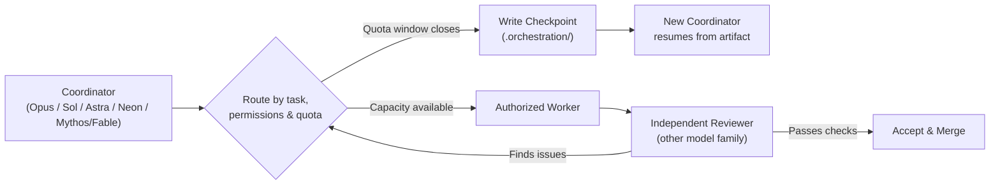
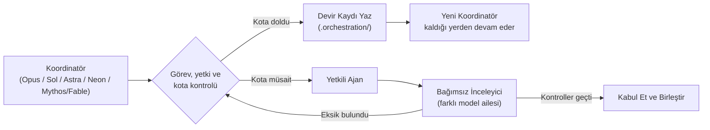

# Ultimate Orchestration Skills

[](https://github.com/ahmedkececi/ultimate-orchestration-skills/actions/workflows/ci.yml)
[](LICENSE)
[](#choose-a-coordinator)
[](#refresh-model-data-on-demand)
[](https://github.com/ahmedkececi/ultimate-orchestration-skills)

[English](#english) · [Türkçe](#türkçe) · [Offline demo](examples/first-run.md) · [Contributing](CONTRIBUTING.md) · [Changelog](CHANGELOG.md)

## English

**Keep your agents working when a model hits its quota.** Add capability-based routing, quota balancing, independent review and restartable handoffs to Claude Code, Codex or Antigravity. The presets guide your coordinator using the model runners and permissions you configure.

- **Right model for each unit:** Routes every task to the most capable and efficient model across four separate benchmark profiles (coding, reasoning, factual accuracy, knowledge/PDF work) using ±3-point equivalence, latency, input type and permissions.
- **Subscription quota balancing & handoffs:** Balances rolling 5-hour and weekly windows across Claude, ChatGPT/Codex, Gemini/Antigravity and optional DeepSeek API, resuming from `.orchestration/` checkpoints when a window closes.
- **Independent cross-family review:** Verifies deliverables with a fresh reviewer from another model family — without exposing the author's reasoning — and adds an extra verification step whenever a fallback drops a tier.

**What this is & prerequisites:** These are portable Markdown Agent Skills plus zero-dependency Python 3.9+ helper scripts for benchmark tracking — not an MCP server, proxy, or background daemon. You can start with 1–2 authorized model pools and add more subscriptions or APIs later; any unconfigured lane falls back automatically to what you have.

[Try the offline benchmark preview](examples/first-run.md#preview-model-data-offline) · [Resolve lanes offline](examples/first-run.md#resolve-lanes-deterministically-offline) · [See a quota handoff](examples/first-run.md#follow-a-quota-handoff)

### Quick install

From your project, choose the command for your client. This copies just the coordinator and the measurement updater into the project. Add the optional provider skill to the same install by appending `--skill add-provider-orchestration-skills`.

```sh
# Codex
npx skills add ahmedkececi/ultimate-orchestration-skills --agent codex --copy \
  --skill sol-orchestration --skill astra-orchestration --skill update-orchestration-skills

# Claude Code
npx skills add ahmedkececi/ultimate-orchestration-skills --agent claude-code --copy \
  --skill opus-orchestration --skill fable-orchestration --skill update-orchestration-skills
```

For Antigravity, another coordinator, or an install without Node.js, clone once and copy the folders into your project (keep the original folder names):

```sh
# Manual / Antigravity (replace neon-orchestration or target directory as needed)
git clone --depth 1 https://github.com/ahmedkececi/ultimate-orchestration-skills.git /tmp/uos
mkdir -p .agents/skills
cp -R /tmp/uos/skills/neon-orchestration /tmp/uos/skills/update-orchestration-skills .agents/skills/
rm -rf /tmp/uos
```

Each coordinator preset uses progressive disclosure (`SKILL.md` plus on-demand `references/` files to save context tokens), so keep the full folder including `references/` when copying.

[Skills CLI options](https://github.com/vercel-labs/skills#usage)

### How it works



### What makes it different

| Design choice | Why it matters |
| --- | --- |
| Route by the task and the quota pool | A fast implementation model, a reviewer who can check a PDF, and the worker with capacity left may be three different choices. The presets account for difficulty, input type, read/write permissions and available allowance. |
| Compare the profiles that matter | Coding, reasoning, factual accuracy and knowledge work are separate signals. Pick a replacement on the evidence that matters for this unit and compare task times only where they were measured on the same basis. |
| Make reviews independent | Give a fresh reviewer from another model family the artifact and acceptance checks. The coordinator sees both the result and its limits before accepting it. |
| Resume from artifacts | The handoff records ownership, accepted decisions, remaining units and the next check. A new coordinator can pick up from the checkpoint when a quota window closes. |
| Refresh without waiting for a release | The updater verifies model releases and measurements from their sources and refreshes the current workspace. The next routing decision can use that data immediately. |
| Deterministic routing & safety guardrails | Rank authorized models offline with `resolve_lanes.py` from live measurements and quota state, while enforcing `BLOCKER`/`NIT` review circuit breakers (max 2 rounds), hung-lane timeout and compaction recovery, test integrity, and an external action gate (`git push`/publish forbidden for workers). |

### Why this instead of a framework or proxy?

| Approach | Built for | Trade-off compared to Ultimate Orchestration Skills |
| --- | --- | --- |
| **Agent frameworks** (`LangGraph`, `CrewAI`) | Building custom multi-agent backend apps | Requires SDKs, orchestration code, state storage and API keys instead of working inside your existing Claude Code, Codex or Antigravity CLI sessions. |
| **API routers / proxies** (`OpenRouter`, `LiteLLM`) | Pay-per-token API routing and failover | Optimizes token price behind an external proxy rather than rolling 5-hour/weekly subscription allowances, cross-family code review or client-to-client checkpoint handoffs. |
| **Single-client subagents** (default `Claude Code` / `Codex`) | Parallel work within one provider pool | Shares one quota pool and usually reviews with the same model family; stalls when that pool hits its cap. |
| **Ultimate Orchestration Skills** | Daily engineering across existing subscriptions | Zero infrastructure, zero proxy, routes each unit to the strongest efficient model across pools, verifies cross-family, hands off across clients via files and refreshes benchmarks live. |

### Choose a coordinator

| Preset | Command | Client & Model | When to pick | Project location |
| --- | --- | --- | --- | --- |
| [Astra](skills/astra-orchestration/) | `$astra-orchestration` | Codex (`gpt-6.2-astra`, medium) | Maximum Codex coordinator reasoning when ChatGPT/Codex allowance is plentiful | `.agents/skills/` |
| [Sol](skills/sol-orchestration/) | `$sol-orchestration` | Codex (`gpt-6.2-sol`, xhigh) | Quota-efficient Codex coordinator (~2.5x lighter on ChatGPT/Codex allowance than Astra) | `.agents/skills/` |
| [Neon](skills/neon-orchestration/) | `/neon-orchestration` | Antigravity (`gemini-4-neon`, high / Orchestrator) | Antigravity main loop with Native Swarm, PDF/media intake and balanced Codex + Claude workers | `.agents/skills/` |
| [Mythos/Fable](skills/fable-orchestration/) | `/fable-orchestration` | Claude Code (`Mythos` or `Fable`) | Frontier Claude coordinator with scarce allowance; offloads routine execution to Codex and Sonnet | `.claude/skills/` |
| [Opus](skills/opus-orchestration/) | `/opus-orchestration` | Claude Code (`Claude Opus 5.5`, high/xhigh) | Everyday Claude Code coordinator, or failover when Mythos/Fable allowance is spent | `.claude/skills/` |

1. Install the chosen coordinator folder and the [update skill folder](skills/update-orchestration-skills/) into the **Project location** above (via `npx skills add` or the manual copy snippet). Keep both folder names unchanged.
2. Copy `project-profile.example.md` from your coordinator folder to `.orchestration/project-profile.md` and reference it from your repository instructions (`CLAUDE.md` or `AGENTS.md`). List authorized runners, data scopes, budget, writable paths and verification commands, and confirm model IDs and effort levels in your client.
3. Invoke the coordinator using the **Command** column above (`/<folder-name>` in Claude Code or Antigravity, `$<folder-name>` in Codex). Start with a bounded deliverable, one eligible worker and a verifiable acceptance check.

### Refresh model data on demand

Run `/update-orchestration-skills` in Claude Code or Antigravity. In Codex use `$update-orchestration-skills`.

- **No model name:** Lists verified releases newer than the presets' reference models and asks which to add. The update looks up benchmarks and saves data for the models you choose. Incomplete catalog coverage is reported alongside the list.
- **One model name:** For example, `/update-orchestration-skills Claude Opus 4.8` requests just that model (showing that named lookups accept any release date — both backfilling older releases and checking brand-new ones). Its exact model ID and any published scores are verified before saving. You can also ask for a preview or import your own measurements.

For each model and effort, the update checks every raw test from the bundled benchmark suite. The output uses `-` for any test result it could not verify. The command uses the client's live source tools and the included Python 3.9+ helper. It merges verified source observations into `.orchestration/model-measurements.md` in the current workspace. Newly announced models can appear with unknown scores. Comparable observations have source links, a date, model and effort, version or cohort, and a count and range for averaged results. The project's access and routing rules still determine which models can run.

The [historical snapshot](skills/update-orchestration-skills/references/model-measurements.md) combines benchmark scores and profile averages in one Markdown file. The [collection guide](skills/update-orchestration-skills/references/collection.md) describes live lookup and custom imports.

### Add a provider

Install [add-provider-orchestration-skills](skills/add-provider-orchestration-skills/) alongside the updater. Run `/add-provider-orchestration-skills PROVIDER` in Claude Code or Antigravity, or `$add-provider-orchestration-skills PROVIDER` in Codex. The agent checks the provider's public catalog and how to call its models. It asks which models you want, then looks up the full benchmark suite for your choices. The provider's sources and setup details go in `.orchestration/provider-catalogs.json`. Future catalog checks include that provider. The project profile still controls which runners can receive work.

### Workspace files, `.gitignore` & FAQ

All runtime artifacts live under `.orchestration/`:

| File | Git status | Purpose |
| --- | --- | --- |
| `.orchestration/project-profile.md` | **Commit** | Authorized runners, data policy, writable paths, budget and verification commands (no secret values) |
| `.orchestration/model-measurements.md` | **Commit** | Verified benchmark snapshot refreshed for this workspace |
| `.orchestration/provider-catalogs.json` | **Commit** | Registered provider catalog sources added via `add-provider-orchestration-skills` |
| `.orchestration/provider-state.json` | **Ignore** | Local account quota readings and reset windows |
| `.orchestration/orchestration-checkpoint.md` | **Ignore** | Active session handoff state |
| `.orchestration/orchestration-ledger.md` | **Ignore** | Sanitized local routing history |

Add the ephemeral local state files to your repository's `.gitignore`:

```gitignore
# Ephemeral local orchestration state
.orchestration/provider-state.json
.orchestration/orchestration-checkpoint.md
.orchestration/orchestration-ledger.md
```

**FAQ**

- **Do I need all four model providers?** No. Start with 1–2 authorized pools in `.orchestration/project-profile.md`; any unconfigured lane is treated as unavailable and routed to your configured fallback.
- **Can I use metered API keys instead of subscriptions?** Yes. The default thresholds (weekly 85% move / 90% stop; 5-hour 90% move / 95% stop) are tuned for rolling subscription pools, and you can record explicit API spending caps in `.orchestration/project-profile.md`.
- **Why didn't my client detect the skill?** Verify the folder name was kept intact (`sol-orchestration`, `opus-orchestration`, etc.) inside `.claude/skills/` (Claude Code) or `.agents/skills/` (Codex / Antigravity), then start a fresh session.

Client docs [Claude Code](https://code.claude.com/docs/en/skills) · [Codex](https://learn.chatgpt.com/docs/build-skills) · [Antigravity](https://antigravity.google/docs/migration/workflows-to-skills/)

## Türkçe

**Bir modelin kotası dolduğunda iş devam etsin.** Claude Code, Codex veya Antigravity’de işe göre en verimli modele yönlendirme, kota dengeleme, bağımsız inceleme ve dosyadan devir ekle. Hazır profiller, projene tanımladığın model çalıştırıcılarını ve yetkileri kullanır.

- **Doğru işe en yetenekli ve verimli model:** Her iş birimini dört ayrı ölçüm profiline (kodlama, muhakeme, olgusal doğruluk, bilgi/PDF işi), ±3 puan eşdeğerlik kuralına, süreye, girdi türüne ve yetkilere göre en uygun modele yönlendirir.
- **Abonelik kota dengeleme ve devir:** Claude, ChatGPT/Codex, Gemini/Antigravity ve isteğe bağlı DeepSeek API havuzlarındaki 5 saatlik ve haftalık pencereleri dengeler; pencere dolduğunda `.orchestration/` devir kayıtlarıyla kesintisiz devam eder.
- **Farklı model ailesinden bağımsız doğrulama:** Çıktıyı yazarın gerekçesini göstermeden başka bir model ailesinden yeni bir inceleyiciye doğrulattırır; yedek modelde kademe düşerse otomatik ek doğrulama adımı uygular.

**Bu nedir ve gereksinimler:** Bu depo, bir MCP sunucusu, vekil (proxy) veya arka plan servisi değil; taşınabilir Markdown Agent Skill’leri ile benchmark takibi için sıfır bağımlılıklı Python 3.9+ yardımcı betiklerinden oluşur. 1–2 yetkili model havuzuyla başlayıp daha sonra yeni abonelikler veya API’ler ekleyebilirsin; yapılandırılmamış her hat otomatik olarak mevcut yedeğe yönlendirilir.

[API anahtarı gerektirmeyen demo](examples/first-run.md#türkçe-kısa-başlangıç) · [Çevrimdışı hat seçimi](examples/first-run.md#resolve-lanes-deterministically-offline) · [Kota devri örneği](examples/first-run.md#follow-a-quota-handoff)

### Hızlı kurulum

Proje dizininde istemcine uygun komutu seç. Bu komut yalnızca seçili koordinatörü ve ölçüm güncelleyicisini projeye kopyalar. İsteğe bağlı sağlayıcı skill’ini aynı kuruluma eklemek için komutun sonuna `--skill add-provider-orchestration-skills` ekle.

```sh
# Codex
npx skills add ahmedkececi/ultimate-orchestration-skills --agent codex --copy \
  --skill sol-orchestration --skill update-orchestration-skills

# Claude Code
npx skills add ahmedkececi/ultimate-orchestration-skills --agent claude-code --copy \
  --skill opus-orchestration --skill update-orchestration-skills
```

Antigravity, farklı bir koordinatör veya Node.js olmadan kurulum için depoyu bir kez klonlayıp ilgili klasörleri projene kopyala (orijinal klasör adlarını koru):

```sh
# Elle kurulum / Antigravity (neon-orchestration veya hedef dizini ihtiyacına göre değiştir)
git clone --depth 1 https://github.com/ahmedkececi/ultimate-orchestration-skills.git /tmp/uos
mkdir -p .agents/skills
cp -R /tmp/uos/skills/neon-orchestration /tmp/uos/skills/update-orchestration-skills .agents/skills/
rm -rf /tmp/uos
```

Her koordinatör profili aşamalı yükleme (`SKILL.md` ve bağlam token’larından tasarruf etmek için gerektiğinde yüklenen `references/` dosyaları) kullanır; bu nedenle kopyalarken `references/` dahil klasörün tamamını koru.

[Skills CLI seçenekleri](https://github.com/vercel-labs/skills#usage)

### Nasıl çalışır?



### Neyi farklı yapıyor?

| Tasarım tercihi | Ne kazandırır? |
| --- | --- |
| Göreve ve kota havuzuna göre yönlendirme | Hızlı kod yazan model, PDF doğrulayabilen model ve kotası müsait model farklı olabilir. Hazır profiller işin zorluğunu, girdi türünü, okuma ve yazma yetkilerini ve kalan kotayı hesaba katar. |
| İşe uygun ölçümleri karşılaştırma | Kodlama, muhakeme, olgusal doğruluk ve bilgi işi ayrı değerlendirilir. Yedek seçerken göreve uygun ölçümleri kullanır, süreleri yalnızca aynı koşullarda ölçüldüklerinde karşılaştırırsın. |
| Bağımsız inceleme | Başka bir model ailesinden yeni bir inceleyiciye çıktıyı ve kabul ölçütlerini verirsin. Koordinatör işi kabul etmeden önce sonucu ve doğrulamanın sınırlarını görür. |
| Dosyalardan devam etme | Devir kaydı, sorumluları, alınan kararları, kalan işleri ve sıradaki kontrolü içerir. Kota penceresi dolduğunda yeni koordinatör kaldığı yerden devam edebilir. |
| Yeni sürüm beklemeden güncelleme | Yenileme skill’i yeni çıkan modelleri ve ölçümlerini kaynaklarından doğrular. Bir sonraki yönlendirme kararı, çalışma alanındaki güncel veriyi kullanabilir. |
| Deterministik yönlendirme ve güvenlik kuralları | Canlı ölçümler ve kota durumundan `resolve_lanes.py` ile yetkili modelleri çevrimdışı sıralar; `BLOCKER`/`NIT` inceleme devre kesicisini (en fazla 2 tur), zaman aşımı ve sıkıştırma kurtarmasını, test bütünlüğünü ve harici işlem kapısını (ajanlar için `git push`/yayınlama yasak) uygular. |

### Neden bir framework veya proxy yerine bu?

| Yaklaşım | Ne için tasarlandı | Ultimate Orchestration Skills’e göre farkı |
| --- | --- | --- |
| **Ajan framework’leri** (`LangGraph`, `CrewAI`) | Özel çoklu ajan arka uç uygulamaları yazmak | Mevcut Claude Code, Codex veya Antigravity oturumlarınla doğrudan çalışmak yerine SDK, orkestrasyon kodu, durum veritabanı ve API anahtarı gerektirir. |
| **API yönlendirici / proxy’ler** (`OpenRouter`, `LiteLLM`) | Token başına ücretli API yönlendirme ve yedekleme | Dönen 5 saatlik/haftalık abonelik kotaları, çapraz aile kod incelemesi veya istemciler arası dosya devri yerine harici bir proxy arkasında token maliyetini optimize eder. |
| **Tek istemcili alt ajanlar** (varsayılan `Claude Code` / `Codex`) | Tek sağlayıcı havuzu içinde paralel çalışma | Tek kota havuzunu paylaşır ve genelde aynı model ailesiyle inceleme yapar; o havuz dolduğunda akış durur. |
| **Ultimate Orchestration Skills** | Mevcut aboneliklerle günlük mühendislik akışı | Sıfır altyapı, sıfır proxy; her birimi havuzlar arasında en yetenekli ve verimli modele yönlendirir, farklı aileyle doğrular, dosyadan başka istemciye devreder ve benchmark’ları canlı günceller. |

### Koordinatör seç

| Hazır profil | Komut | İstemci ve Model | Ne zaman seçmeli | Projedeki konumu |
| --- | --- | --- | --- | --- |
| [Astra](skills/astra-orchestration/) | `$astra-orchestration` | Codex (`gpt-6.2-astra`, medium) | ChatGPT/Codex kotası bolken en yüksek Codex koordinatör muhakemesi için | `.agents/skills/` |
| [Sol](skills/sol-orchestration/) | `$sol-orchestration` | Codex (`gpt-6.2-sol`, xhigh) | Kota tasarruflu Codex koordinatörü (ChatGPT/Codex kotasında Astra’dan ~2,5 kat daha hafif) | `.agents/skills/` |
| [Neon](skills/neon-orchestration/) | `/neon-orchestration` | Antigravity (`gemini-4-neon`, high / Orchestrator) | Native Swarm, PDF/medya işleme ve dengeli Codex + Claude ajanlarıyla Antigravity ana döngüsü | `.agents/skills/` |
| [Mythos/Fable](skills/fable-orchestration/) | `/fable-orchestration` | Claude Code (`Mythos` veya `Fable`) | Kısıtlı kotalı en üst düzey Claude koordinatörü; rutin uygulamayı Codex ve Sonnet’e devreder | `.claude/skills/` |
| [Opus](skills/opus-orchestration/) | `/opus-orchestration` | Claude Code (`Claude Opus 5.5`, high/xhigh) | Günlük Claude Code koordinatörü veya Mythos/Fable kotası dolduğunda devralma seçeneği | `.claude/skills/` |

1. Seçtiğin koordinatör klasörünü ve [yenileme skill’i klasörünü](skills/update-orchestration-skills/) yukarıdaki **Projedeki konumu** dizinine kur (`npx skills add` veya elle kopyalama komutuyla). Her iki klasör adını da değiştirme.
2. Koordinatör klasöründeki `project-profile.example.md` dosyasını `.orchestration/project-profile.md` olarak kopyala ve depo talimatlarından (`CLAUDE.md` veya `AGENTS.md`) bu dosyaya referans ver. Yetkili çalıştırıcıları, veri kapsamını, bütçeyi, yazılabilir yolları ve doğrulama komutlarını belirt; model kimliklerini ve efor seviyelerini istemcinde doğrula.
3. Koordinatörü yukarıdaki **Komut** sütunundaki adla çağır (Claude Code ve Antigravity’de `/<klasör-adı>`, Codex’te `$<klasör-adı>`). Kapsamı belli, tek bir uygun ajana verilebilen ve ölçülebilir kabul kriteri olan bir işle başla.

### Model verilerini istediğin anda yenile

Claude Code veya Antigravity’de `/update-orchestration-skills`, Codex’te `$update-orchestration-skills` yaz.

- **Model adı yoksa:** Hazır profillerdeki referans sürümlerden daha yeni, doğrulanmış modelleri listeler ve hangilerini eklemek istediğini sorar. Sadece seçtiğin modellerin benchmark sonuçlarını araştırır ve kaydeder. Eksik taramalar listede belirtilir.
- **Bir model adı varsa:** Örneğin `/update-orchestration-skills Claude Opus 4.8` yalnızca o modeli arar (ad verilerek yapılan aramalarda tarih sınırı olmadığını — hem eski sürümleri geriye dönük doldurmayı hem de yepyeni modelleri sorgulamayı — gösterir). Tam model kimliğini ve yayımlanmış skorları doğrulayıp kaydeder. Önizleme isteyebilir veya kendi ölçüm verini de içe aktarabilirsin.

Güncelleme, her model ve efor seviyesi için arşivdeki testlerin tamamını arar. Doğrulanamayan test sonuçlarını tabloda `-` ile gösterir. Komut, istemcinin canlı kaynak araçlarını ve paketteki Python 3.9+ yardımcısını kullanır. Doğrulanan ölçümleri çalışma alanındaki `.orchestration/model-measurements.md` dosyasına yazar. Yeni duyurulmuş bir modelin skoru henüz yoksa bu alan bilinmiyor olarak kalır. Karşılaştırılabilir ölçümler kaynak bağlantısı, tarih, model, efor ve ölçüm sürümüyle birlikte gösterilir. Ortalamalarda ölçüm sayısı ve aralığı yer alır. Hangi modellerin kullanılabileceğini projenin yetki ve yönlendirme kuralları belirler.

[Arşiv](skills/update-orchestration-skills/references/model-measurements.md), benchmark skorlarını ve profil ortalamalarını tek Markdown dosyasında birleştirir. [Veri toplama kılavuzu](skills/update-orchestration-skills/references/collection.md) canlı aramayı ve özel veri aktarmayı açıklar.

### Sağlayıcı ekle

[add-provider-orchestration-skills](skills/add-provider-orchestration-skills/) klasörünü güncelleyicinin yanına kur. Claude Code veya Antigravity’de `/add-provider-orchestration-skills SAĞLAYICI`, Codex’te `$add-provider-orchestration-skills SAĞLAYICI` yaz. Ajan resmî kataloğu ve modellerin nasıl çağrıldığını araştırır. Hangilerini eklemek istediğini sorar, ardından seçtiklerin için benchmark listesinin tamamını kontrol eder. Sağlayıcının kaynaklarını ve kurulum bilgilerini `.orchestration/provider-catalogs.json` dosyasına kaydeder. Sonraki katalog taramaları bu sağlayıcıyı da içerir. Hangi çalıştırıcılara görev verilebileceğini proje profili belirler.

### Çalışma alanı dosyaları, `.gitignore` ve SSS

Tüm çalışma zamanı dosyaları `.orchestration/` altında tutulur:

| Dosya | Git durumu | Amaç |
| --- | --- | --- |
| `.orchestration/project-profile.md` | **Commit et** | Yetkili çalıştırıcılar, veri politikası, yazılabilir yollar, bütçe ve doğrulama komutları (gizli anahtar değerleri olmadan) |
| `.orchestration/model-measurements.md` | **Commit et** | Bu çalışma alanı için yenilenmiş doğrulanmış benchmark özeti |
| `.orchestration/provider-catalogs.json` | **Commit et** | `add-provider-orchestration-skills` ile kaydedilmiş sağlayıcı katalog kaynakları |
| `.orchestration/provider-state.json` | **Yoksay** | Yerel hesap kota okumaları ve sıfırlanma pencereleri |
| `.orchestration/orchestration-checkpoint.md` | **Yoksay** | Aktif oturum devir kaydı |
| `.orchestration/orchestration-ledger.md` | **Yoksay** | Temizlenmiş yerel yönlendirme geçmişi |

Geçici yerel durum dosyalarını deponun `.gitignore` dosyasına ekle:

```gitignore
# Geçici yerel orkestrasyon durumu
.orchestration/provider-state.json
.orchestration/orchestration-checkpoint.md
.orchestration/orchestration-ledger.md
```

**SSS**

- **Dört model sağlayıcısının hepsine ihtiyacım var mı?** Hayır. `.orchestration/project-profile.md` içinde 1–2 yetkili havuzla başlayabilirsin; yapılandırılmamış hatlar kullanılamaz kabul edilir ve tanımlı yedeğe yönlendirilir.
- **Abonelik yerine ücretli API anahtarları kullanabilir miyim?** Evet. Varsayılan eşikler (haftalık %85 taşıma / %90 durdurma; 5 saatlik %90 taşıma / %95 durdurma) yenilenen abonelik havuzlarına göre ayarlanmıştır; `.orchestration/project-profile.md` içine açık API harcama sınırları da yazabilirsin.
- **İstemcim skill’i neden görmüyor?** Klasör adının değiştirilmediğini (`sol-orchestration`, `opus-orchestration` vb.) ve Claude Code için `.claude/skills/`, Codex / Antigravity için `.agents/skills/` altında bulunduğunu doğrula, ardından yeni bir oturum başlat.

İstemci belgeleri [Claude Code](https://code.claude.com/docs/en/skills) · [Codex](https://learn.chatgpt.com/docs/build-skills) · [Antigravity](https://antigravity.google/docs/migration/workflows-to-skills/)

## License · Lisans

[MIT](LICENSE)
