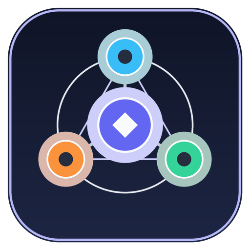
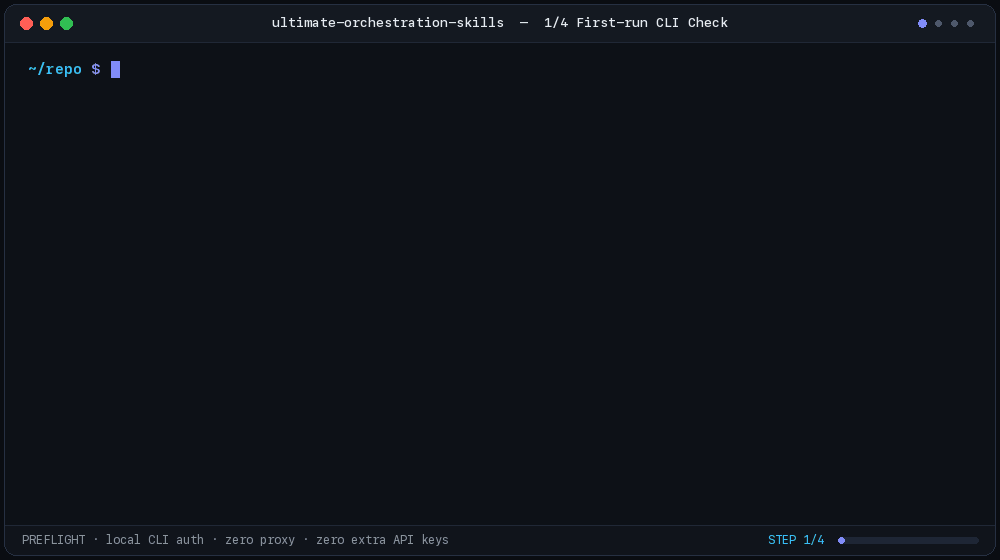
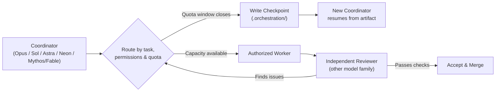
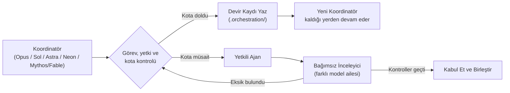

#  Ultimate Orchestration Skills

[](https://github.com/ahmedkececi/ultimate-orchestration-skills/actions/workflows/ci.yml)
[](LICENSE)
[](#choose-a-coordinator)
[](#refresh-model-data-on-demand)
[](https://github.com/ahmedkececi/ultimate-orchestration-skills)

[English](#english) · [Türkçe](#türkçe) · [Interactive simulator](https://ahmedkececi.github.io/ultimate-orchestration-skills/) · [Offline demo](examples/first-run.md) · [Contributing](CONTRIBUTING.md) · [Changelog](CHANGELOG.md)



## English

**Keep your agents working when a model hits its quota.** Add capability-based routing, quota balancing, independent review and restartable handoffs to Claude Code, Codex or Antigravity. The presets guide your coordinator using the model runners and permissions you configure.

- **Right model for each unit:** Routes every task to the most capable and efficient model across four separate benchmark profiles (coding, reasoning, factual accuracy, knowledge/PDF work) using ±3-point equivalence, latency, input type and permissions.
- **Subscription quota balancing & handoffs:** Balances rolling 5-hour and weekly windows across Claude, ChatGPT/Codex, Gemini/Antigravity and optional DeepSeek API, resuming from `.orchestration/` checkpoints when a window closes.
- **Independent cross-family review:** Verifies deliverables with a fresh reviewer from another model family — without exposing the author's reasoning — and adds an extra verification step whenever a fallback drops a tier.

**What this is & prerequisites:** These are portable Markdown Agent Skills plus zero-dependency Python 3.9+ helper scripts for benchmark tracking — not an MCP server, proxy, or background daemon. You can start with 1–2 authorized model pools and add more subscriptions or APIs later; record your authorized lanes in `.orchestration/project-profile.md`, and any unconfigured lane is skipped in favor of your authorized pools.

[Interactive simulator](https://ahmedkececi.github.io/ultimate-orchestration-skills/) · [Try the offline benchmark preview](examples/first-run.md#preview-model-data-offline) · [Resolve lanes offline](examples/first-run.md#resolve-lanes-deterministically-offline) · [See a quota handoff](examples/first-run.md#follow-a-quota-handoff)

### Quick install

Pick the fastest option for your client — each installs the recommended coordinator preset(s) plus the live benchmark updater:

**1. Claude Code native plugin (1 step, zero Node.js):**

```text
/plugin install ultimate-orchestration-skills --marketplace ahmedkececi/ultimate-orchestration-skills
```

**2. One-line shell installer (no Node.js — Codex, Claude Code, Antigravity):**

```sh
curl -fsSL https://raw.githubusercontent.com/ahmedkececi/ultimate-orchestration-skills/main/install.sh | sh -s -- --client codex
# or: --client claude | --client antigravity | --preset sol --with-provider
```

Re-running the installer never deletes anything: an existing skill folder is moved to `skill-backups/<skill>-<UTC timestamp>/` next to the skills directory (for example `.claude/skill-backups/`, outside `skills/` so it is not loaded as a duplicate skill) and files that are not part of upstream are listed; `--dry-run` prints this plan without moving anything.

**3. Skills CLI (`npx skills add`):**

```sh
# Codex
npx skills add ahmedkececi/ultimate-orchestration-skills --agent codex --copy \
  --skill sol-orchestration --skill astra-orchestration --skill update-orchestration-skills

# Claude Code
npx skills add ahmedkececi/ultimate-orchestration-skills --agent claude-code --copy \
  --skill opus-orchestration --skill fable-orchestration --skill update-orchestration-skills
```

To install a single coordinator with `npx skills add`, omit the other coordinator's `--skill` flag; add the optional provider onboarding skill with `--skill add-provider-orchestration-skills` (or `--with-provider` in `install.sh`). Each coordinator preset uses progressive disclosure (`SKILL.md` plus on-demand `references/` files to save context tokens), so keep the full folder including `references/` if copying manually.

[Skills CLI options](https://github.com/vercel-labs/skills#usage) · [Inspect `install.sh`](install.sh)

### How it works



### Concrete impact

| Metric | Impact | Basis |
| --- | --- | --- |
| **Upfront skill context load** | **~49–55% fewer tokens** | *Measured* — lossless progressive disclosure splitting `SKILL.md` + on-demand `references/` |
| **Primary flagship quota runway** | **~2.2× – 3.5× longer** before hitting a cap | *Modeled* for 2–3 active pools + offloading non-flagship units (`Sol` coordinator is also ~2.5× lighter on Codex quota than `Astra`) |
| **Flagship model token consumption** | **~40–65% fewer flagship tokens** | *Modeled* — offloading routine coding, PDF/media reading, and bulk cleanup to specialized/lighter lanes + compact 4-line delegation return + 2-round `BLOCKER` circuit breaker |
| **Total session token overhead** | **~25–45% fewer tokens overall** | *Modeled* — eliminating redundant wide reads in the main loop and long retry loops |

*Methodology note:* Upfront skill context reduction is measured directly from this repository's progressive-disclosure split. Quota runway and token ranges are modeled estimates for typical 2–3 pool workflows and vary by task mix, active subscriptions, and effort levels. Try the [interactive simulator](https://ahmedkececi.github.io/ultimate-orchestration-skills/) to calculate custom estimates for your own stack.

### What makes it different

| Design choice | Why it matters |
| --- | --- |
| Route by the task and the quota pool | A fast implementation model, a reviewer who can check a PDF, and the worker with capacity left may be three different choices. The presets account for difficulty, input type, read/write permissions and available allowance. |
| Compare the profiles that matter | Coding, reasoning, factual accuracy and knowledge work are separate signals. Pick a replacement on the evidence that matters for this unit and compare task times only where they were measured on the same basis. |
| Make reviews independent | Give a fresh reviewer from another model family the artifact and acceptance checks. The coordinator sees both the result and its limits before accepting it. |
| Resume from artifacts | The handoff records ownership, accepted decisions, remaining units and the next check. A new coordinator can pick up from the checkpoint when a quota window closes. |
| Refresh without waiting for a release | The updater verifies model releases and measurements from their sources and refreshes the current workspace. The next routing decision can use that data immediately. |
| Deterministic routing & safety guardrails | Rank authorized models offline with `resolve_lanes.py` from live measurements and quota state, while enforcing `BLOCKER`/`NIT` review circuit breakers (max 2 rounds), hung-lane timeout and compaction recovery, test integrity, and an external action gate (`git push`/publish forbidden for workers). |
| Self-calibrating pre-dispatch quota guard | Checks live usage right before dispatching each unit and right after it finishes, projects consumption with `resolve_lanes.py --unit-size <xs\|s\|m\|l\|xl>` (`current + est_burn × safety_margin`), blocks `projected-overflow` units (e.g. an ~11% `l` task at 89% five-hour) before they hit a cap mid-work, and adapts automatically to your exact plan (Pro / Plus / Max / Team) via EWMA (`--record-burn`). |

### Why this instead of a framework or proxy?

| Approach | Built for | Trade-off compared to Ultimate Orchestration Skills |
| --- | --- | --- |
| **Agent frameworks** (`LangGraph`, `CrewAI`) | Building custom multi-agent backend apps | Requires SDKs, orchestration code, state storage and API keys instead of working inside your existing Claude Code, Codex or Antigravity CLI sessions. |
| **Local AI gateways / proxies** (`OmniRoute`, `LiteLLM`) | Unifying API keys and OAuth tokens behind a local proxy with HTTP load balancing and `429` failover | Runs a local daemon, redirects CLI traffic through a proxy/token store, and swaps raw HTTP requests reactively on `429` — without preserving each native CLI's tools, proactive subscription thresholds, benchmark-profile routing, cross-family review, or client-to-client checkpoint handoffs. |
| **Hosted API routers** (`OpenRouter`) | Pay-per-token cloud API routing | Optimizes token price on metered API calls rather than rolling 5-hour/weekly subscription allowances, native CLI agents, or cross-family verification. |
| **Single-client subagents** (default `Claude Code` / `Codex`) | Parallel work within one provider pool | Shares one quota pool and usually reviews with the same model family; stalls when that pool hits its cap. |
| **Ultimate Orchestration Skills** | Daily engineering across existing subscriptions | Zero infrastructure, zero proxy, native CLI sessions only; routes each task unit by benchmark profile and proactive quota headroom, verifies cross-family, hands off across clients via files, and refreshes benchmarks live. |

> **How it stands out from open-source local proxies like OmniRoute:**
> - **Zero daemon, zero proxy, zero token vault:** Never runs a local server or SQLite token store and never intercepts CLI OAuth traffic. `claude`, `codex`, and `agy` stay on their official native sign-ins and tool sandboxes.
> - **Task-level orchestration, not HTTP request swapping:** Splits work into owned units with writable-path boundaries and routes each unit across 4 separate benchmark profiles (coding, reasoning, factual accuracy, knowledge/PDF) — instead of blindly rerouting a mid-session HTTP call after a `429`.
> - **Self-calibrating pre-dispatch quota guard & clean client handoffs:** Uses unified **90% move / 95% stop** thresholds for both 5-hour and weekly windows, checks live quota pre-dispatch and post-unit, projects unit burn via `resolve_lanes.py --unit-size` to block `projected-overflow` units (like an ~11% `l` task at 89% 5-hour) *before* they stall mid-work, auto-calibrates per-plan burn via EWMA (`--record-burn`), and transfers full manager ownership to another client via `.orchestration/orchestration-checkpoint.md` when a window closes.
> - **Independent cross-family review & safety guardrails:** Verifies deliverables with a fresh reviewer from another model family, enforces a 2-round `BLOCKER`/`NIT` circuit breaker and test-integrity checks, blocks workers from external actions (`git push`/publish), and ranks lanes deterministically offline with `resolve_lanes.py` plus live benchmark updates.

### Choose a coordinator

| Preset | Command | Client & Model | When to pick | Project location |
| --- | --- | --- | --- | --- |
| [Astra](skills/astra-orchestration/) | `$astra-orchestration` | Codex (`gpt-6.2-astra`, medium) | Maximum Codex coordinator reasoning when ChatGPT/Codex allowance is plentiful | `.agents/skills/` |
| [Sol](skills/sol-orchestration/) | `$sol-orchestration` | Codex (`gpt-6.2-sol`, xhigh) | Quota-efficient Codex coordinator (~2.5x lighter on ChatGPT/Codex allowance than Astra) | `.agents/skills/` |
| [Neon](skills/neon-orchestration/) | `/neon-orchestration` | Antigravity (`gemini-4-neon`, high / Orchestrator) | Antigravity main loop with Native Swarm, PDF/media intake and balanced Codex + Claude workers | `.agents/skills/` |
| [Mythos/Fable](skills/fable-orchestration/) | `/fable-orchestration` | Claude Code (`Mythos` or `Fable`) | Frontier Claude coordinator with scarce allowance; offloads routine execution to Codex and Sonnet | `.claude/skills/` |
| [Opus](skills/opus-orchestration/) | `/opus-orchestration` | Claude Code (`Claude Opus 5.5`, high/xhigh) | Everyday Claude Code coordinator, or failover when Mythos/Fable allowance is spent | `.claude/skills/` |

1. Install the chosen coordinator folder and the [update skill folder](skills/update-orchestration-skills/) into the **Project location** above (via `/plugin install`, `install.sh`, or `npx skills add`). Keep all skill folder names unchanged.
2. Start a chat in your project root using the **Command** column above (`/<folder-name>` in Claude Code or Antigravity, `$<folder-name>` in Codex). On a fresh repository where `.orchestration/` does not exist yet, the coordinator automatically checks which worker CLIs (`claude`, `codex`, `agy`) are installed and signed in, asks which pools you want to enable, helps you install (with your approval) and sign in to any missing or signed-out CLI you want to use, and then creates `.orchestration/project-profile.md` (with its `<!-- orchestration-lanes:v1 -->` block) and `.orchestration/provider-state.json` before starting your task. *(If you prefer manual setup first, copy `project-profile.example.md` from your coordinator folder to `.orchestration/project-profile.md` and reference it from `CLAUDE.md` or `AGENTS.md`.)*

#### What to type in chat

Right after installing, open chat in your project folder and paste the setup prompt for your client — no placeholders to edit and no manual file copying required:

```text
# Claude Code — first-run setup & CLI readiness
/opus-orchestration Check my installed CLIs (claude, codex, agy) and sign-in status, guide me through installing or signing in to the ones I want to use, set up .orchestration/ if missing, and wait for me to give you a task to delegate.

# Codex — first-run setup & CLI readiness
$sol-orchestration Check my installed CLIs (claude, codex, agy) and sign-in status, guide me through installing or signing in to the ones I want to use, set up .orchestration/ if missing, and wait for me to give you a task to delegate.

# Antigravity — first-run setup & CLI readiness
/neon-orchestration Check my installed CLIs (claude, codex, agy) and sign-in status, guide me through installing or signing in to the ones I want to use, set up .orchestration/ if missing, and wait for me to give you a task to delegate.

# Any client — resume after a quota handoff (swap command for your client)
$sol-orchestration Read .orchestration/orchestration-checkpoint.md and .orchestration/provider-state.json, run git status --short, and continue the remaining units.
```

<details>
<summary>CLI install &amp; sign-in quick reference (optional — your coordinator also checks these on first run)</summary>

```sh
# 1. Check installed binaries & sign-in status
command -v claude codex agy
CI=true claude auth status --text
codex login status
agy --help

# 2. Install only the CLIs you plan to use
npm install -g @anthropic-ai/claude-code                             # Claude Code
npm install -g @openai/codex                                         # Codex
curl -fsSL https://antigravity.google/cli/install.sh | bash          # Antigravity (macOS/Linux)
# Windows PowerShell: irm https://antigravity.google/cli/install.ps1 | iex

# 3. Sign in interactively in your terminal (never paste tokens into chat)
claude             # then run /login (or: claude auth login)
codex login        # or: codex login --device-auth
agy auth login     # or launch: agy (use --no-browser over SSH)
```

</details>

See more ready-to-paste examples (including setup-only preflight and Turkish prompts) in [examples/first-run.md](examples/first-run.md#what-to-type-in-chat).

### Refresh model data on demand

Run `/update-orchestration-skills` in Claude Code or Antigravity. In Codex use `$update-orchestration-skills`.

- **No model name:** Lists verified releases newer than the presets' reference models and asks which to add. The update looks up benchmarks and saves data for the models you choose. Incomplete catalog coverage is reported alongside the list.
- **One model name:** For example, `/update-orchestration-skills Claude Opus 4.8` requests just that model (showing that named lookups accept any release date — both backfilling older releases and checking brand-new ones). Its exact model ID and any published scores are verified before saving. You can also ask for a preview or import your own measurements.

For each model and effort, the update checks every raw test from the bundled benchmark suite. The output uses `-` for any test result it could not verify. The command uses the client's live source tools and the included Python 3.9+ helper. It merges verified source observations into `.orchestration/model-measurements.md` in the current workspace. Newly announced models can appear with unknown scores. Comparable observations have source links, a date, model and effort, version or cohort, and a count and range for averaged results. The project's access and routing rules still determine which models can run.

The [historical snapshot](skills/update-orchestration-skills/references/model-measurements.md) combines benchmark scores and profile averages in one Markdown file. The [collection guide](skills/update-orchestration-skills/references/collection.md) describes live lookup and custom imports.

### Add a provider

Install [add-provider-orchestration-skills](skills/add-provider-orchestration-skills/) alongside the updater. Run `/add-provider-orchestration-skills PROVIDER` in Claude Code or Antigravity, or `$add-provider-orchestration-skills PROVIDER` in Codex. The agent checks the provider's public catalog and how to call its models. It asks which models you want, then looks up the full benchmark suite for your choices. The provider's sources and setup details go in `.orchestration/provider-catalogs.json`. Future catalog checks include that provider. The project profile still controls which runners can receive work.

### Workspace files, `.gitignore` & FAQ

All runtime artifacts live under `.orchestration/`:

| File | Git status | Purpose |
| --- | --- | --- |
| `.orchestration/project-profile.md` | **Commit** | Authorized runners, data policy, writable paths, budget and verification commands (no secret values) |
| `.orchestration/model-measurements.md` | **Commit** | Verified benchmark snapshot refreshed for this workspace |
| `.orchestration/provider-catalogs.json` | **Commit** | Registered provider catalog sources added via `add-provider-orchestration-skills` |
| `.orchestration/provider-state.json` | **Ignore** | Local account quota readings, reset windows, and self-calibrating EWMA burn history (`_calibration`) |
| `.orchestration/orchestration-checkpoint.md` | **Commit** (recommended: the handover history survives across clients; ignore only if you keep handovers local) | Active session handoff state; the coordinator commits it before a handover |
| `.orchestration/orchestration-ledger.md` | **Commit** (recommended: the handover history survives across clients; ignore only if you keep handovers local) | Sanitized routing history |

Add only the machine-local quota file to your repository's `.gitignore`:

```gitignore
# Local account quota readings
.orchestration/provider-state.json
```

**FAQ**

- **Do I need all four model providers?** Start with 1–2 pools and record the permitted model, effort, pool and roles for each worker in `.orchestration/project-profile.md`. Without the authorization block, the offline resolver shows an advisory ranking and leaves its recommendation empty.
- **Can I use metered API keys instead of subscriptions?** Yes. The default unified thresholds (**90% move / 95% stop** for both 5-hour and weekly windows) are tuned for rolling subscription pools, and you can record explicit API spending caps in `.orchestration/project-profile.md`.
- **How does the self-calibrating pre-dispatch quota guard adapt to my plan (Pro / Plus / Max / Team)?** Before each unit, the coordinator reads live quota and runs `resolve_lanes.py --unit-size <xs|s|m|l|xl>` (`projected = current + est_burn × safety_margin`), blocking any `projected-overflow` (`>= 95%`, such as an ~11% `l` unit at 89% five-hour) before work starts. After each unit finishes, it logs real before/after usage with `--record-burn` into `.orchestration/provider-state.json` (`_calibration` EWMA, automatically skipping EWMA updates on window resets), so burn estimates quickly converge to your exact subscription plan. For Codex, run `python3 -B skills/update-orchestration-skills/scripts/read_quota.py --write` first: it reads the newest Codex session log (no interactive `/status`) and refreshes `observed_at`; ChatGPT web usage shares the weekly pool but is not in that log. If the resolver's recommended lane is `deprioritized` (`"dispatch_ok": false` in `--format json`), do not dispatch new units to that pool: take the next ladder step or wait for the reset.
- **Why didn't my client detect the skill?** Verify the folder name was kept intact (`sol-orchestration`, `opus-orchestration`, etc.) inside `.claude/skills/` (Claude Code) or `.agents/skills/` (Codex / Antigravity), then start a fresh session.

Client docs [Claude Code](https://code.claude.com/docs/en/skills) · [Codex](https://learn.chatgpt.com/docs/build-skills) · [Antigravity](https://antigravity.google/docs/migration/workflows-to-skills/)

## Türkçe

**Bir modelin kotası dolduğunda iş devam etsin.** Claude Code, Codex veya Antigravity’de işe göre en verimli modele yönlendirme, kota dengeleme, bağımsız inceleme ve dosyadan devir ekle. Hazır profiller, projene tanımladığın model çalıştırıcılarını ve yetkileri kullanır.

- **Doğru işe en yetenekli ve verimli model:** Her iş birimini dört ayrı ölçüm profiline (kodlama, muhakeme, olgusal doğruluk, bilgi/PDF işi), ±3 puan eşdeğerlik kuralına, süreye, girdi türüne ve yetkilere göre en uygun modele yönlendirir.
- **Abonelik kota dengeleme ve devir:** Claude, ChatGPT/Codex, Gemini/Antigravity ve isteğe bağlı DeepSeek API havuzlarındaki 5 saatlik ve haftalık pencereleri dengeler; pencere dolduğunda `.orchestration/` devir kayıtlarıyla kesintisiz devam eder.
- **Farklı model ailesinden bağımsız doğrulama:** Çıktıyı yazarın gerekçesini göstermeden başka bir model ailesinden yeni bir inceleyiciye doğrulattırır; yedek modelde kademe düşerse otomatik ek doğrulama adımı uygular.

**Bu nedir ve gereksinimler:** Bu depo, bir MCP sunucusu, vekil (proxy) veya arka plan servisi değil; taşınabilir Markdown Agent Skill’leri ile benchmark takibi için sıfır bağımlılıklı Python 3.9+ yardımcı betiklerinden oluşur. 1–2 yetkili model havuzuyla başlayıp daha sonra yeni abonelikler veya API’ler ekleyebilirsin; yetkili hatlarını `.orchestration/project-profile.md` dosyasına kaydettiğinde yapılandırılmamış her hat atlanarak yetkili havuzların kullanılır.

[Etkileşimli simülatör](https://ahmedkececi.github.io/ultimate-orchestration-skills/) · [API anahtarı gerektirmeyen demo](examples/first-run.md#türkçe-kısa-başlangıç) · [Çevrimdışı hat seçimi](examples/first-run.md#resolve-lanes-deterministically-offline) · [Kota devri örneği](examples/first-run.md#follow-a-quota-handoff)

### Hızlı kurulum

İstemcin için en hızlı yöntemi seç — her biri önerilen koordinatör profil(ler)ini ve canlı benchmark güncelleyicisini kurar:

**1. Claude Code yerel eklentisi (tek adım, Node.js gerekmez):**

```text
/plugin install ultimate-orchestration-skills --marketplace ahmedkececi/ultimate-orchestration-skills
```

**2. Tek satırlık kabuk kurucusu (Node.js gerekmez — Codex, Claude Code, Antigravity):**

```sh
curl -fsSL https://raw.githubusercontent.com/ahmedkececi/ultimate-orchestration-skills/main/install.sh | sh -s -- --client codex
# veya: --client claude | --client antigravity | --preset sol --with-provider
```

Kurulum betiğini yeniden çalıştırmak hiçbir şeyi silmez: mevcut bir skill klasörü skills dizininin yanındaki `skill-backups/<skill>-<UTC zaman damgası>/` klasörüne taşınır (örneğin `.claude/skill-backups/`; `skills/` dışında olduğu için yinelenen skill olarak yüklenmez) ve upstream'de olmayan dosyalar listelenir; `--dry-run` bu planı hiçbir şeyi taşımadan yazdırır.

**3. Skills CLI (`npx skills add`):**

```sh
# Codex
npx skills add ahmedkececi/ultimate-orchestration-skills --agent codex --copy \
  --skill sol-orchestration --skill astra-orchestration --skill update-orchestration-skills

# Claude Code
npx skills add ahmedkececi/ultimate-orchestration-skills --agent claude-code --copy \
  --skill opus-orchestration --skill fable-orchestration --skill update-orchestration-skills
```

`npx skills add` ile tek bir koordinatör kurmak için diğer koordinatörün `--skill` seçeneğini kaldır; isteğe bağlı sağlayıcı ekleme skill’ini kurmak için `--skill add-provider-orchestration-skills` (veya `install.sh` içinde `--with-provider`) ekle. Her koordinatör profili aşamalı yükleme (`SKILL.md` ve bağlam token’larından tasarruf etmek için gerektiğinde yüklenen `references/` dosyaları) kullanır; bu nedenle elle kopyalarken `references/` dahil klasörün tamamını koru.

[Skills CLI seçenekleri](https://github.com/vercel-labs/skills#usage) · [`install.sh` betiğini incele](install.sh)

### Nasıl çalışır?



### Somut etki

| Metrik | Etki | Dayanak |
| --- | --- | --- |
| **Başlangıç skill bağlam yükü** | **~%49–55 daha az token** | *Ölçüldü* — `SKILL.md` + gerektiğinde yüklenen `references/` ile kayıpsız aşamalı yükleme |
| **Birincil amiral gemisi kota ömrü** | Limite ulaşmadan **~2,2× – 3,5× daha uzun** | *Modellendi* — 2–3 aktif havuz + rutin iş birimlerini devretme (`Sol` koordinatörü de Codex kotasında `Astra`’dan ~2,5× daha hafiftir) |
| **Amiral gemisi model token tüketimi** | **~%40–65 daha az amiral gemisi token’ı** | *Modellendi* — rutin kodlama, PDF/medya okuma ve toplu temizliği uzman/daha hafif hatlara devretme + 4 satırlık kompakt dönüş + en fazla 2 turluk `BLOCKER` devre kesici |
| **Toplam oturum token yükü** | **Genelde ~%25–45 daha az token** | *Modellendi* — ana döngüdeki gereksiz geniş okumaları ve uzun tekrar döngülerini ortadan kaldırma |

*Yöntem notu:* Başlangıç skill bağlam tasarrufu doğrudan bu depodaki aşamalı yükleme ayrımından ölçülmüştür. Kota ömrü ve token aralıkları tipik 2–3 havuzlu iş akışları için modellenmiş tahminlerdir; görev dağılımına, aktif aboneliklere ve efor seviyelerine göre değişir. Kendi yığının için özel tahmin hesaplamak üzere [etkileşimli simülatörü](https://ahmedkececi.github.io/ultimate-orchestration-skills/) deneyebilirsin.

### Neyi farklı yapıyor?

| Tasarım tercihi | Ne kazandırır? |
| --- | --- |
| Göreve ve kota havuzuna göre yönlendirme | Hızlı kod yazan model, PDF doğrulayabilen model ve kotası müsait model farklı olabilir. Hazır profiller işin zorluğunu, girdi türünü, okuma ve yazma yetkilerini ve kalan kotayı hesaba katar. |
| İşe uygun ölçümleri karşılaştırma | Kodlama, muhakeme, olgusal doğruluk ve bilgi işi ayrı değerlendirilir. Yedek seçerken göreve uygun ölçümleri kullanır, süreleri yalnızca aynı koşullarda ölçüldüklerinde karşılaştırırsın. |
| Bağımsız inceleme | Başka bir model ailesinden yeni bir inceleyiciye çıktıyı ve kabul ölçütlerini verirsin. Koordinatör işi kabul etmeden önce sonucu ve doğrulamanın sınırlarını görür. |
| Dosyalardan devam etme | Devir kaydı, sorumluları, alınan kararları, kalan işleri ve sıradaki kontrolü içerir. Kota penceresi dolduğunda yeni koordinatör kaldığı yerden devam edebilir. |
| Yeni sürüm beklemeden güncelleme | Yenileme skill’i yeni çıkan modelleri ve ölçümlerini kaynaklarından doğrular. Bir sonraki yönlendirme kararı, çalışma alanındaki güncel veriyi kullanabilir. |
| Deterministik yönlendirme ve güvenlik kuralları | Canlı ölçümler ve kota durumundan `resolve_lanes.py` ile yetkili modelleri çevrimdışı sıralar; `BLOCKER`/`NIT` inceleme devre kesicisini (en fazla 2 tur), zaman aşımı ve sıkıştırma kurtarmasını, test bütünlüğünü ve harici işlem kapısını (ajanlar için `git push`/yayınlama yasak) uygular. |
| Kendini kalibre eden iş öncesi kota koruması | Her iş birimini başlatmadan hemen önce ve bitince canlı kotayı okur, `resolve_lanes.py --unit-size <xs\|s\|m\|l\|xl>` ile öngörülen tüketimi (`mevcut + tahmini_tüketim × güvenlik_payı`) hesaplar, `projected-overflow` birimlerini (örn. 5 saatlik %89’dayken ~%11 harcayan bir `l` görevi) yarıda limite takılmadan engeller ve EWMA (`--record-burn`) ile aboneliğinin gerçek hızına (Pro / Plus / Max / Team) otomatik uyum sağlar. |

### Neden bir framework veya proxy yerine bu?

| Yaklaşım | Ne için tasarlandı | Ultimate Orchestration Skills’e göre farkı |
| --- | --- | --- |
| **Ajan framework’leri** (`LangGraph`, `CrewAI`) | Özel çoklu ajan arka uç uygulamaları yazmak | Mevcut Claude Code, Codex veya Antigravity oturumlarınla doğrudan çalışmak yerine SDK, orkestrasyon kodu, durum veritabanı ve API anahtarı gerektirir. |
| **Yerel AI gateway / proxy’ler** (`OmniRoute`, `LiteLLM`) | API anahtarlarını ve OAuth oturumlarını yerel bir proxy arkasında toplayıp HTTP yük dengeleme ve `429` yedeği sunmak | Yerel bir arka plan servisi/token deposu çalıştırır, CLI trafiğini proxy’den geçirir ve `429` geldiğinde ham HTTP isteğini tepkisel olarak değiştirir; her CLI’ın kendi yerel araçlarını, proaktif abonelik eşiklerini, benchmark profili bazlı yönlendirmeyi, çapraz aile incelemesini veya istemciler arası devir kaydını sağlamaz. |
| **Bulut API yönlendiricileri** (`OpenRouter`) | Token başına ücretli bulut API yönlendirme | Dönen 5 saatlik/haftalık abonelik kotaları, yerel CLI ajanları veya çapraz aile doğrulaması yerine ücretli API çağrılarında token maliyetini optimize eder. |
| **Tek istemcili alt ajanlar** (varsayılan `Claude Code` / `Codex`) | Tek sağlayıcı havuzu içinde paralel çalışma | Tek kota havuzunu paylaşır ve genelde aynı model ailesiyle inceleme yapar; o havuz dolduğunda akış durur. |
| **Ultimate Orchestration Skills** | Mevcut aboneliklerle günlük mühendislik akışı | Sıfır altyapı, sıfır proxy, yalnızca resmî CLI oturumları; her iş birimini benchmark profiline ve proaktif kalan kotaya göre yönlendirir, farklı model ailesiyle doğrular, dosyadan başka istemciye devreder ve benchmark’ları canlı günceller. |

> **OmniRoute gibi açık kaynaklı yerel proxy’lerden nasıl ayrışır?**
> - **Sıfır arka plan servisi, sıfır proxy, sıfır token deposu:** Yerel sunucu veya SQLite token kasası çalıştırmaz, CLI OAuth trafiğini araya girerek yönlendirmez. `claude`, `codex` ve `agy` kendi resmî oturumları ve yerel araç/sandbox ortamlarıyla doğrudan çalışır.
> - **Ham HTTP isteği değiştirme değil, görev düzeyinde orkestrasyon:** `429` hatası gelince oturum ortasında körü körüne API isteği yönlendirmek yerine, işi yazılabilir dosya sınırlarıyla birimlere böler ve her birimi 4 ayrı benchmark profiline (kodlama, muhakeme, olgusal doğruluk, bilgi/PDF) göre en uygun ajana verir.
> - **Kendini kalibre eden iş öncesi kota koruması ve temiz istemci devri:** Hem 5 saatlik hem haftalık pencerede birleşik **%90 taşıma / %95 durdurma** eşiklerini uygular; iş öncesi ve iş sonrası canlı kotayı okur, `resolve_lanes.py --unit-size` ile `projected-overflow` birimlerini (örn. 5 saatlik %89’dayken ~%11’lik bir `l` işini) yarıda durmadan *önce* engeller, EWMA (`--record-burn`) ile plana özel tüketimi otomatik kalibre eder ve pencere kapandığında koordinatörlüğü `.orchestration/orchestration-checkpoint.md` üzerinden başka bir istemciye kayıpsız devreder.
> - **Farklı model ailesinden bağımsız inceleme ve güvenlik kapıları:** Çıktıyı başka bir model ailesinden taze bir inceleyiciye doğrulattırır, en fazla 2 turluk `BLOCKER`/`NIT` devre kesicisi ve test bütünlüğü kontrolü uygular, ajanların harici işlemlerini (`git push`/yayınlama) engeller ve `resolve_lanes.py` + canlı benchmark güncellemesiyle çevrimdışı deterministik sıralama yapar.

### Koordinatör seç

| Hazır profil | Komut | İstemci ve Model | Ne zaman seçmeli | Projedeki konumu |
| --- | --- | --- | --- | --- |
| [Astra](skills/astra-orchestration/) | `$astra-orchestration` | Codex (`gpt-6.2-astra`, medium) | ChatGPT/Codex kotası bolken en yüksek Codex koordinatör muhakemesi için | `.agents/skills/` |
| [Sol](skills/sol-orchestration/) | `$sol-orchestration` | Codex (`gpt-6.2-sol`, xhigh) | Kota tasarruflu Codex koordinatörü (ChatGPT/Codex kotasında Astra’dan ~2,5 kat daha hafif) | `.agents/skills/` |
| [Neon](skills/neon-orchestration/) | `/neon-orchestration` | Antigravity (`gemini-4-neon`, high / Orchestrator) | Native Swarm, PDF/medya işleme ve dengeli Codex + Claude ajanlarıyla Antigravity ana döngüsü | `.agents/skills/` |
| [Mythos/Fable](skills/fable-orchestration/) | `/fable-orchestration` | Claude Code (`Mythos` veya `Fable`) | Kısıtlı kotalı en üst düzey Claude koordinatörü; rutin uygulamayı Codex ve Sonnet’e devreder | `.claude/skills/` |
| [Opus](skills/opus-orchestration/) | `/opus-orchestration` | Claude Code (`Claude Opus 5.5`, high/xhigh) | Günlük Claude Code koordinatörü veya Mythos/Fable kotası dolduğunda devralma seçeneği | `.claude/skills/` |

1. Seçtiğin koordinatör klasörünü ve [yenileme skill’i klasörünü](skills/update-orchestration-skills/) yukarıdaki **Projedeki konumu** dizinine kur (`/plugin install`, `install.sh` veya `npx skills add` ile). Tüm skill klasör adlarını olduğu gibi koru.
2. Proje dizininde istemcini aç ve yukarıdaki **Komut** sütunundaki adla sohbeti başlat (Claude Code ve Antigravity’de `/<klasör-adı>`, Codex’te `$<klasör-adı>`). Çalışma alanında `.orchestration/` henüz yoksa koordinatör durmak yerine önce hangi çalışan CLI’ların (`claude`, `codex`, `agy`) kurulu ve oturum açık olduğunu kontrol eder, hangi havuzları kullanmak istediğini sorar, eksik veya oturumu kapalı olanlar için (onayınla) kurulum ve oturum açma adımlarında seni yönlendirir; ardından `.orchestration/project-profile.md` (JSON yetki bloğuyla) ve `.orchestration/provider-state.json` dosyalarını oluşturup görevine başlar. *(İstersen önceden elle de `project-profile.example.md` dosyasını `.orchestration/project-profile.md` olarak kopyalayıp `CLAUDE.md` veya `AGENTS.md` içinden referans verebilirsin.)*

#### Chate ne yazarak başlarsın?

Kurulumdan hemen sonra yer tutucu düzenlemeye veya elle dosya kopyalamaya gerek kalmadan istemcine uygun başlangıç mesajını doğrudan yapıştırabilirsin:

```text
# Claude Code — ilk kurulum ve CLI kontrolü
/opus-orchestration Kurulu CLI'ları (claude, codex, agy) ve oturum durumlarını kontrol et, kullanmak istediklerimin kurulumu/oturum açması için beni yönlendir, .orchestration/ henüz yoksa kur; delege etmek için sana görev vermemi bekle.

# Codex — ilk kurulum ve CLI kontrolü
$sol-orchestration Kurulu CLI'ları (claude, codex, agy) ve oturum durumlarını kontrol et, kullanmak istediklerimin kurulumu/oturum açması için beni yönlendir, .orchestration/ henüz yoksa kur; delege etmek için sana görev vermemi bekle.

# Antigravity — ilk kurulum ve CLI kontrolü
/neon-orchestration Kurulu CLI'ları (claude, codex, agy) ve oturum durumlarını kontrol et, kullanmak istediklerimin kurulumu/oturum açması için beni yönlendir, .orchestration/ henüz yoksa kur; delege etmek için sana görev vermemi bekle.

# Kota devri sonrası başka istemciden devam et (komutu istemcine göre değiştir)
$sol-orchestration .orchestration/orchestration-checkpoint.md ve .orchestration/provider-state.json dosyalarını oku, git status --short çalıştır ve kalan iş birimlerinden devam et.
```

<details>
<summary>CLI kurulum ve oturum açma hızlı başvuru (isteğe bağlı — koordinatör ilk çalıştırmada bunları da kontrol eder)</summary>

```sh
# 1. Kurulu CLI'ları ve oturum durumunu kontrol et
command -v claude codex agy
CI=true claude auth status --text
codex login status
agy --help

# 2. Yalnızca kullanmak istediğin CLI'ları kur
npm install -g @anthropic-ai/claude-code                             # Claude Code
npm install -g @openai/codex                                         # Codex
curl -fsSL https://antigravity.google/cli/install.sh | bash          # Antigravity (macOS/Linux)
# Windows PowerShell: irm https://antigravity.google/cli/install.ps1 | iex

# 3. Kendi terminalinde etkileşimli oturum aç (sohbete asla anahtar/token yapıştırma)
claude             # ardından /login yaz (veya: claude auth login)
codex login        # veya: codex login --device-auth
agy auth login     # veya başlat: agy (SSH üzerinde --no-browser kullan)
```

</details>

Yalnızca kurulum ön kontrolü ve ek örnek komutlar için [examples/first-run.md](examples/first-run.md#chate-ne-yazarak-başlarsın) dosyasına bakabilirsin.

### Model verilerini istediğin anda yenile

Claude Code veya Antigravity’de `/update-orchestration-skills`, Codex’te `$update-orchestration-skills` yaz.

- **Model adı yoksa:** Hazır profillerdeki referans sürümlerden daha yeni, doğrulanmış modelleri listeler ve hangilerini eklemek istediğini sorar. Sadece seçtiğin modellerin benchmark sonuçlarını araştırır ve kaydeder. Eksik taramalar listede belirtilir.
- **Bir model adı varsa:** Örneğin `/update-orchestration-skills Claude Opus 4.8` yalnızca o modeli arar (ad verilerek yapılan aramalarda tarih sınırı olmadığını — hem eski sürümleri geriye dönük doldurmayı hem de yepyeni modelleri sorgulamayı — gösterir). Tam model kimliğini ve yayımlanmış skorları doğrulayıp kaydeder. Önizleme isteyebilir veya kendi ölçüm verini de içe aktarabilirsin.

Güncelleme, her model ve efor seviyesi için arşivdeki testlerin tamamını arar. Doğrulanamayan test sonuçlarını tabloda `-` ile gösterir. Komut, istemcinin canlı kaynak araçlarını ve paketteki Python 3.9+ yardımcısını kullanır. Doğrulanan ölçümleri çalışma alanındaki `.orchestration/model-measurements.md` dosyasına yazar. Yeni duyurulmuş bir modelin skoru henüz yoksa bu alan bilinmiyor olarak kalır. Karşılaştırılabilir ölçümler kaynak bağlantısı, tarih, model, efor ve ölçüm sürümüyle birlikte gösterilir. Ortalamalarda ölçüm sayısı ve aralığı yer alır. Hangi modellerin kullanılabileceğini projenin yetki ve yönlendirme kuralları belirler.

[Arşiv](skills/update-orchestration-skills/references/model-measurements.md), benchmark skorlarını ve profil ortalamalarını tek Markdown dosyasında birleştirir. [Veri toplama kılavuzu](skills/update-orchestration-skills/references/collection.md) canlı aramayı ve özel veri aktarmayı açıklar.

### Sağlayıcı ekle

[add-provider-orchestration-skills](skills/add-provider-orchestration-skills/) klasörünü güncelleyicinin yanına kur. Claude Code veya Antigravity’de `/add-provider-orchestration-skills SAĞLAYICI`, Codex’te `$add-provider-orchestration-skills SAĞLAYICI` yaz. Ajan resmî kataloğu ve modellerin nasıl çağrıldığını araştırır. Hangilerini eklemek istediğini sorar, ardından seçtiklerin için benchmark listesinin tamamını kontrol eder. Sağlayıcının kaynaklarını ve kurulum bilgilerini `.orchestration/provider-catalogs.json` dosyasına kaydeder. Sonraki katalog taramaları bu sağlayıcıyı da içerir. Hangi çalıştırıcılara görev verilebileceğini proje profili belirler.

### Çalışma alanı dosyaları, `.gitignore` ve SSS

Tüm çalışma zamanı dosyaları `.orchestration/` altında tutulur:

| Dosya | Git durumu | Amaç |
| --- | --- | --- |
| `.orchestration/project-profile.md` | **Commit et** | Yetkili çalıştırıcılar, veri politikası, yazılabilir yollar, bütçe ve doğrulama komutları (gizli anahtar değerleri olmadan) |
| `.orchestration/model-measurements.md` | **Commit et** | Bu çalışma alanı için yenilenmiş doğrulanmış benchmark özeti |
| `.orchestration/provider-catalogs.json` | **Commit et** | `add-provider-orchestration-skills` ile kaydedilmiş sağlayıcı katalog kaynakları |
| `.orchestration/provider-state.json` | **Yoksay** | Yerel hesap kota okumaları, sıfırlanma pencereleri ve kendini kalibre eden EWMA tüketim geçmişi (`_calibration`) |
| `.orchestration/orchestration-checkpoint.md` | **Commit et** (önerilir: devir geçmişi istemciler arasında korunur; yalnızca devirleri yerelde tutuyorsan yoksay) | Aktif oturum devir kaydı; koordinatör devirden önce commit eder |
| `.orchestration/orchestration-ledger.md` | **Commit et** (önerilir: devir geçmişi istemciler arasında korunur; yalnızca devirleri yerelde tutuyorsan yoksay) | Temizlenmiş yönlendirme geçmişi |

Yalnızca makineye özel kota dosyasını deponun `.gitignore` dosyasına ekle:

```gitignore
# Yerel hesap kota okumaları
.orchestration/provider-state.json
```

**SSS**

- **Dört model sağlayıcısının hepsine ihtiyacım var mı?** 1–2 havuzla başlayabilir, her işçi için izin verdiğin model, efor, havuz ve rolleri `.orchestration/project-profile.md` dosyasına yazabilirsin. Yetki bloğu eksikse çevrimdışı yönlendirici bilgi amaçlı bir sıralama gösterir ve öneri alanını boş bırakır.
- **Abonelik yerine ücretli API anahtarları kullanabilir miyim?** Evet. Varsayılan birleşik eşikler (hem 5 saatlik hem haftalık pencereler için **%90 taşıma / %95 durdurma**) yenilenen abonelik havuzlarına göre ayarlanmıştır; `.orchestration/project-profile.md` içine açık API harcama sınırları da yazabilirsin.
- **Kendini kalibre eden iş öncesi kota koruması benim planıma (Pro / Plus / Max / Team) nasıl uyum sağlar?** Koordinatör her iş biriminden önce canlı kotayı okur ve `resolve_lanes.py --unit-size <xs|s|m|l|xl>` (`öngörülen = mevcut + tahmini_tüketim × güvenlik_payı`) çalıştırarak `projected-overflow` (`>= %95`; örn. 5 saatlik %89’dayken ~%11’lik bir `l` işi) durumunu iş başlamadan engeller. Birim bitince gerçek önce/sonra kullanımını `--record-burn` ile `.orchestration/provider-state.json` (`_calibration` EWMA; pencere sıfırlanırsa EWMA güncellemesini otomatik atlar) içine kaydeder; böylece tahminler kendi abonelik planına hızla uyum sağlar. Codex için önce `python3 -B skills/update-orchestration-skills/scripts/read_quota.py --write` çalıştır: en yeni Codex oturum günlüğünü okur (etkileşimli `/status` gerekmez) ve `observed_at` değerini yeniler; ChatGPT web kullanımı aynı haftalık havuzu paylaşır ama bu günlükte yer almaz. Yönlendiricinin önerdiği hat `deprioritized` ise (`--format json` çıktısında `"dispatch_ok": false`), o havuza yeni iş verme: merdivende bir sonraki adıma geç veya sıfırlanmayı bekle.
- **İstemcim skill’i neden görmüyor?** Klasör adının değiştirilmediğini (`sol-orchestration`, `opus-orchestration` vb.) ve Claude Code için `.claude/skills/`, Codex / Antigravity için `.agents/skills/` altında bulunduğunu doğrula, ardından yeni bir oturum başlat.

İstemci belgeleri [Claude Code](https://code.claude.com/docs/en/skills) · [Codex](https://learn.chatgpt.com/docs/build-skills) · [Antigravity](https://antigravity.google/docs/migration/workflows-to-skills/)

## License · Lisans

[MIT](LICENSE)
